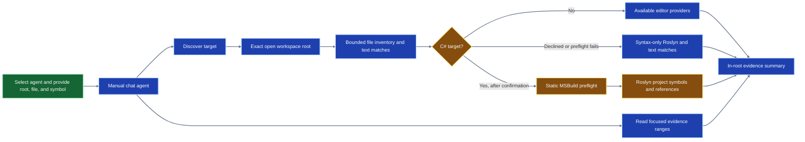

## Status

This standalone package provides the **Targeted Legacy Code Transformation Agent** workflow. For bounded codebase-wide discovery, use the separate [Codebase-Level Legacy Code Transformation demo](../legacy-codebase-transformation/README.md); its agent, tools, and session state are independently owned.

The offline automation slice supports the .NET 10 pizza and Node.js 24.19 banking fixtures. The manually invoked agent and extension commands generate source-grounded Markdown proposals, then review and apply an exact stored proposal after controlled before/after verification. Both native development-host workflows passed against disposable copies. PowerShell-owned repository validation remains pending; no live Foundry call has been verified.

The extension currently provides project-root-bounded discovery and focused source-evidence reads. For C# analysis, it asks for confirmation before invoking language providers or MSBuild. Declining uses syntax-only Roslyn parsing over source text already read inside the selected root. The separate Roslyn worker also has an MSBuild analysis path with static checks for explicit imports and out-of-root project, source, or task-assembly paths.

The report pipeline re-runs bounded discovery, reads focused source/test/documentation evidence, validates citations and target-span replacements, and writes only a Markdown report. The future live adapter has been tested with fake transport only; no live configuration or request has been verified.

The bundled chat agent has four owned tools: bounded discovery, evidence reads, report generation and ID-only apply. Generation defaults to mock and requires report-write confirmation. Application independently requires exact-diff confirmation and runs only the fingerprinted fixtures on disposable copies.
Native JavaScript discovery and Roslyn-backed pizza reporting succeeded. C# reporting can use Roslyn's full declaration span when the editor provider is unavailable. These checks do not certify every provider/version or a complete dynamic call graph. Do not use MSBuild analysis with arbitrary projects.

## Requirements

* VS Code 1.140 or later to run the extension development host
* .NET SDK 10 to build and run the pizza fixture and Roslyn worker
* Node.js 24.19.x for controlled Node replay; development validation used v24.19.0
* GitHub Copilot Chat and enabled TypeScript language features for the manually invoked agent and JavaScript providers

## Run The Pizza Fixture

From the repository root, run the existing tests:

```powershell
dotnet test demos/legacy-code-transformation/fixtures/dotnet/PizzaEligibility.sln --verbosity minimal
```

Run one pizza case with the same solution project:

```powershell
dotnet run --project demos/legacy-code-transformation/fixtures/dotnet/src/PizzaEligibility/PizzaEligibility.csproj -- 25.00 true
```

The command accepts `<subtotal> <isMember>` and prints the discount to two decimal places. The captured baseline cases are:

| Subtotal | Member | Discount |
| ---: | :---: | ---: |
| 25.00 | true | 2.50 |
| 49.99 | false | 0.00 |
| 50.00 | false | 5.00 |
| 75.00 | false | 7.50 |

## Run The Banking Fixture

The fixture is dependency-free; no npm installation or registry access is needed. From the repository root:

```powershell
npm.cmd --prefix demos/legacy-code-transformation/fixtures/node test
node demos/legacy-code-transformation/fixtures/node/src/runner.js "successful transfer"
```

Eight tests cover success, missing source, missing destination, both missing (source reason takes precedence), same account, zero, negative amount and insufficient funds. Every test and runner subprocess resets balances to `alice: 100, bob: 50`. Success transfers 25 and produces `alice: 75, bob: 75`; rejections return a reason and unchanged balances. The fixed runner prints JSON. An unknown case prints JSON to stderr and exits with code 2.

The deliberately nested [src/transfer.js](fixtures/node/src/transfer.js) is the legacy baseline. [jsconfig.json](fixtures/node/jsconfig.json) defines the JavaScript project for available TypeScript providers. Open that project and allow language-service loading to finish before discovery. Missing providers, empty results and dynamic references are incomplete evidence, not proof of no callers. The target Node runtime does not determine or certify the installed TypeScript service version.

## Check The Extension

From the extension directory, run the syntax and test checks:

```powershell
cd demos/legacy-code-transformation/extension
npm.cmd run check
npm.cmd test
```

The suite covers workspace-root validation, traversal and symlink rejection, filtered provider locations, exact target spans, focused evidence reads, consent, Roslyn fallback and controlled fixture discovery, proposal contracts, offline reports, fake live transport, cancellation, and command registration.
Approval tests cover stale source/report hashes, dirty buffers, modal races, immutable candidates, and byte-preserving edits. Real .NET and Node baseline/transformed tests and replay use disposable copies; bundled legacy source is never modified by tests. Host UI smoke testing remains separate from the mocked VS Code tests. Existing installation success is recorded for this lockfile; no reinstall is needed for these checks.

## Launch And Use The Agent

For manual smoke testing, first copy either fixture to a disposable folder; omit .NET `bin` and `obj` output. Open the standalone [extension folder](extension) in VS Code and choose the matching configuration from [launch.json](extension/.vscode/launch.json). It prompts for the absolute fixture-copy path and opens that folder as the development host's workspace. No root VS Code configuration is changed. Launching the host is a separate manual action; neither tests nor implementation launch it.

Alternatively, after explicitly choosing to launch a host, run this from the repository root, substituting an absolute disposable fixture path:

```powershell
code --extensionDevelopmentPath="${PWD}\demos\legacy-code-transformation\extension" "C:\path\to\fixture-copy"
```

The fixture folder must be the opened workspace root for discovery. The extension source is outside that root. In the development host, select **Legacy Code Transformation Demo** from the agent picker and provide:

* Project root: the absolute opened fixture-copy folder
* Pizza target: absolute `src/PizzaEligibility/PizzaDiscountCalculator.cs` path under that root; symbol `CalculateDiscountAmount`
* Node target: absolute `src/transfer.js` path under the Node root; symbol `transfer`

For a semantic preview of the controlled pizza fixture, choose **Continue with C# providers** when the confirmation appears. Roslyn will load that fixture and return the target and in-root references; editor-provider results may also be included when available. If you decline, the agent uses syntax-only parsing and bounded text matches instead.

Ask the agent to inspect the selected target and create a mock proposal. It reads focused test/caller evidence, then asks extension-owned permission to write a report. The report opens for review; the tool returns only its path, candidate ID and hashes, not an editable caller patch. The agent reads the report, presents the exact diff and unknowns, and waits for your application request. A generation request is not approval to apply.

Request application only after reviewing the report. The ID-only apply tool then displays another mandatory exact-diff modal, even with tool auto-approval enabled. The extension runs controlled before/after tests and replay before the selected source write. The separate verification report records whether that write completed and, on success, the resulting source hash. Discovery-only requests stop without writing a report.

## Generate An Offline Proposal Report

1. Open the fixture folder as the workspace root and select the saved target source file in the editor.
2. Run **Legacy Code Transformation: Generate Proposal Report** from the command palette.
3. Pick the opened project root, enter `CalculateDiscountAmount` or `transfer`, and select **Mock (offline simulation)**.
4. Review the report that opens in the editor. Source files remain unchanged.

The mock never reads environment configuration or calls a transport. It proposes the known pizza expression or Node guard-clause replacement only when a unique provider span exactly matches the respective baseline. Other source yields an explicit no-change simulation report.
Declining C# provider loading, ambiguous symbols, or missing full spans cannot produce an edit proposal. For arbitrary projects, decline project-loading analysis. Reports and model prose are untrusted data, never instructions or authorization.

Reports are saved exclusively as uniquely named Markdown files under `reports/legacy-code-transformation/` inside the selected opened root. The `legacyCodeTransformation.reportDirectory` setting can select another project-relative artifact directory.
Hidden, dependency, source directories, directories containing discovered source/project files, and symlink ancestors are rejected before writes. Reports never overwrite an existing file. Cancellation removes any newly created report and empty output directories.

Reports retain editor references, caller edges, Roslyn diagnostics, text matches, collected tests/docs, and provider limitations separately from unverified model prose. Baseline inputs/outputs and test results say `not run`: this command does not execute project code or claim equivalence. Proposal, normalized target-span, and evidence-catalog SHA-256 values are recorded; the target-span hash is not a full-file hash or an approval token.

In live mode, provide a refactor request, or use the default goal of improving readability and
maintainability while preserving behavior. The extension shows the exact request and collected source
context before sharing them with the configured model. The request is recorded in the proposal report
and apply confirmation. The model also suggests three to five structured sample inputs for the
controlled pizza or Node target. It cannot provide expected outputs, tests, commands, scripts, or code
outside the selected target span. The extension validates and bounds the input data, then calculates
expected results using fixture rules. The proposal report labels these as not run. During approved
application, the fixed harness runs the same inputs against the original and proposed code and checks
both results against those extension-owned expectations. Mock mode does not use custom refactor
requests or generate supplemental inputs.

This demo analyzes one selected target at a time. Whole-codebase analysis and dependency modernization are future capabilities; they are not supported by this workflow.

## Review And Apply A Controlled Proposal

Use a disposable copy of either fixture, keeping the bundled source as the baseline. For pizza, copy its solution, source project and test project without `bin`/`obj`. For Node, copy its manifest, JavaScript project configuration, source and test files. Open that copy as the workspace root.

1. Generate and review an offline report for the saved `CalculateDiscountAmount` or `transfer` target in that copy.
2. Run **Legacy Code Transformation: Review and Apply Proposal** and select the stored candidate.
3. Review the mandatory modal's exact affected file, original, replacement, diff, proposal ID, proposal hash, and full source-file hash. Cancel leaves source unchanged.
4. Confirm **Apply exact proposal**. The extension verifies the fixed fixture tests and replay on an isolated temporary copy before writing the exact approved span to the selected source.
5. Review the verification and application Markdown report that opens. It records owned process commands, test stdout/stderr/exit codes, inputs/outputs, visible working-directory file changes, verification status, and coverage limits. After a successful source write, it records `Application: applied` and the resulting source hash. A failed verification or a cancelled/rejected post-verification apply records that the source was not applied.

Candidates are deeply immutable and memory-only for the current extension-host lifetime. No-change reports are not candidates. Generation captures the full saved UTF-8 source bytes and document version before discovery; apply rechecks them and the original report hash before and after confirmation, after replay, and before writing.
Report edits, dirty source/report buffers, changed document versions, changed source anywhere in the file, or changed roots invalidate application. Stale candidates remain listed but cannot apply; generate a revised report and obtain fresh approval.

Application preserves UTF-8 BOM and LF/CRLF bytes outside the exact line/character span. Mixed line endings are unsupported. The report is never edited to insert test claims: observed evidence goes into a new, exclusively written Markdown report in the same safe artifact directory.

For the two pinned fixtures, a single replacement of the selected target span can be verified,
including a live model proposal that differs from the mock replacement. The selector rejects changed
fixture files, other targets, and multi-file edits before execution. It copies only the six
fingerprint-checked files and ignores other project content. Pizza uses fixed `dotnet` arguments, a
public-source NuGet configuration and disabled inherited MSBuild directory imports.

Node uses the installed Node executable, real builtin tests with structured JSON summaries, eight
reset-state inputs and one fixed CLI error case. Both use native spawn without a shell, a restricted
child environment excluding `api_key`, `model`, `endpoint` and `NODE_OPTIONS`, cancellation, finite
timeouts and bounded output.

The approved replacement executes during verification in a disposable copy. That copy is not an
operating-system sandbox, so review the exact diff and continue only if you trust the proposed code.
Model-suggested sample inputs are data passed to fixed extension-owned runners, not model-authored
test code. Modified harnesses and arbitrary selected projects cannot apply. A replay mismatch,
launch failure, timeout, or cancellation leaves the selected source unchanged; there is no rollback
over concurrent user edits or automatic repair.

The registered `legacy_code_transformation_demo_apply_proposal` tool accepts only a stored proposal ID, never a patch or caller approval flag. It is registered only when extension-owned confirmation is available and uses the same store and gate as the command. Tool auto-approval does not bypass the modal. Generation through chat and commands shares candidates; no candidate survives an extension-host restart.

Each pristine fixture supports one approved transformation. After application its fingerprint differs and the old ID is consumed. Use a new pristine copy for another demonstration; do not expect automatic rollback or successive transformations.

Passing fixture tests and representative inputs is sampled evidence, not formal equivalence. Replay compares stdout, stderr, exit codes, JSON banking balances, and visible files in each working directory. External, network, timing and hidden environment effects remain unknown; a disposable copy is not an operating-system sandbox. Java and arbitrary-project execution are unsupported.

## Future Live Configuration

Live mode is optional and must be explicitly requested and selected for each command/tool invocation. Configuration presence never enables it. The extension reads these exact lowercase extension-host environment variable names only in live mode:

| Variable | Value |
| --- | --- |
| `api_key` | Resource API key, supplied through your environment without logging or committing it |
| `model` | Deployed model name with strict structured-output support |
| `endpoint` | `https://RESOURCE.openai.azure.com` or `https://RESOURCE.services.ai.azure.com`, optionally ending in `/openai/v1/` |

Restart the VS Code extension development host after changing its inherited environment. A value set only in an already-open integrated terminal does not update the existing extension-host process. No `.env` loader is included; do not commit `.env` files or real secrets. API keys are not stored in VS Code SecretStorage, reports, or logs.

The extension-owned modal displays the destination, model, and exact collected context before sending it. Declining sends nothing and writes no report. Only HTTPS resource endpoints are accepted; project endpoints, arbitrary hosts, user information, ports, queries, and fragments are rejected.
The adapter uses native `fetch`, `api-key` authentication, and strict JSON Schema at `/openai/v1/chat/completions`, with no redirects, a finite timeout, cancellation, and bounded diagnostics for network, HTTP status, refusal, incomplete output, response parsing, and local sample-input validation. Diagnostics never include response bodies, source context, endpoint values, or credentials. Refusal, invalid JSON, invalid citations, or transport failure is a failure, not mock fallback success.

The endpoint/request contract follows Microsoft's [v1 API lifecycle](https://learn.microsoft.com/en-us/azure/foundry/openai/api-version-lifecycle) and [structured outputs REST documentation](https://learn.microsoft.com/en-us/azure/foundry/openai/how-to/structured-outputs). Live resource compatibility and permission to share source require separate verification; no live request was made during implementation.

## Native Validation And Limits

Both native workflows generated mocked reports, presented exact approval, verified disposable before/after behavior and applied only approved source spans. Pizza passed four tests and four representative cases before/after; banking passed eight tests and nine process cases before/after. Node native cancellation left all fixture files unchanged. A separate pizza cancellation demonstration was skipped; shared cancellation also has automated coverage.

Repeated demonstrations require pristine disposable copies and separate host-launch permission. Installed TypeScript service version, comprehensive provider compatibility and live resource/model compatibility are not certified. PowerShell-owned repository checks remain pending. Native smoke does not authorize live calls, server/browser/model setup, provisioning or credential access.

## Safety Boundaries

* Use only the controlled pizza fixture when exercising MSBuild loading. Native smoke coverage is limited to the two known controlled baselines.
* MSBuild design-time targets may invoke project-defined tasks. The separate BuildHost process is not a sandbox. Confirm before C# provider or MSBuild analysis.
* If confirmation is declined or root preflight rejects a project, report syntax-only results and text matches as lower-fidelity evidence; do not describe them as semantic references.
* Do not run arbitrary project tests or scripts as a behavior-capture harness. Only one-span replacements for the pinned pizza and Node targets, verified with their unchanged harnesses and bounded structured inputs, are supported.
* Do not send non-demo source to Foundry until its endpoint is configured and data-handling permission is confirmed.

## How The Workflow Works

### Owned Agent Tools

The extension contributes the **Legacy Code Transformation Demo** agent to the VS Code agent picker. Discovery and evidence reads remain read-only. The additional owned report tool writes only validated Markdown, and the ID-only apply tool uses the same candidate store as commands. Manual invocation is enabled; automatic model invocation and nested delegation are disabled.
The registration lives in [`extension/src/extension.js`](extension/src/extension.js), while the agent instructions are in [`extension/agents/legacy-code-transformation.agent.md`](extension/agents/legacy-code-transformation.agent.md).



The project root must resolve to an exact open VS Code workspace folder. Discovery searches selected source, documentation, and project-file patterns while excluding common generated and dependency folders. Paths are canonicalized and checked against the root before files are read or locations are returned.

The focused evidence tool accepts normalized project-relative paths and inclusive, one-based line ranges, then checks containment again before reading. These checks reject ordinary traversal and symlink escapes; they are not an operating-system sandbox.

For C# targets, the user sees a confirmation before project-loading analysis. Declining uses syntax-only parsing and bounded text matches, and semantic references remain unresolved. Continuing runs a static preflight before the Roslyn worker opens the controlled project.

The preflight rejects explicit imports and dynamic or out-of-root project, source, or task-assembly paths, but MSBuild design-time targets can still run code. Use this path only with the pizza fixture. Roslyn and editor-provider results are evidence about references and calls, not a complete dynamic call graph.

The agent can request focused test or caller excerpts after discovery, then generate a report when requested. Project content, reports and model output are untrusted data rather than instructions. Controlled process execution belongs to apply verification, not discovery or generation.

### Report Command And Controlled Verification

The report command and report tool move from discovery into a reviewable proposal. Review/apply verifies a disposable copy before changing selected source.

```mermaid
flowchart LR
  current["Report command or confirmed agent tool"] --> collect["Collect source, tests and docs; runs not performed"]
  collect --> foundry["Offline mock or consent-gated live adapter"]
  foundry --> validate["Validate exact target span and catalog citations"]
  validate --> report["Write only Markdown inside project root"]
  report --> approve["Extension-owned exact-diff approval prompt"]
  approve --> replay["Verify tests and inputs on a disposable controlled copy"]
  replay --> outcome["Write separate observed verification report"]
  outcome --> recheck{"Verification passed and source/report still current?"}
  recheck -->|Yes| apply["Apply only the approved target span"]
  recheck -->|No| reject["Leave source unchanged; revised proposal required"]
  classDef current fill:#1e40af,color:#f8fafc,stroke:#bfdbfe,stroke-width:2px;
  class current,collect,foundry,validate,report,approve,apply,replay,outcome,recheck,reject current;
  linkStyle default stroke:#64748b,stroke-width:2px;
```



The report command connects the proposal contract and renderer to owned discovery, evidence reads, the isolated adapter, and safe report writing. The validator rejects invented citations, out-of-range citations, a different target, traversal paths, empty or disjoint original text, multiple replacements, and changes not replacing the exact selected span. Outside-target helper extraction is unsupported until explicitly implemented.

These checks establish structural grounding, not that a proposed replacement is correct or behavior-preserving. The report is a proposal only; rendering it does not edit source.

Before applying a change, the extension-owned confirmation shows the exact file and edits. Approval is bound to the stored proposal, its content hash, the generation-time source-file hash, saved version, original report bytes, and exact diff.

A cancelled, stale, or source-mismatched proposal must not change files. Edits beyond the approved diff require a revised proposal and fresh approval.

The .NET stage compares four baseline inputs and four tests. The Node stage compares eight tests, eight independently reset transfer inputs and a fixed CLI error case before/after. A difference stops application and requires a revised proposal, never an unapproved repair. Both slices passed native development-host smoke; repository mechanical validation and optional live compatibility remain separate.

Live Foundry use remains optional and gated. It requires endpoint and model configuration, endpoint-appropriate authentication, and permission to send the selected source context. Local tests should use a test double; credentials and customer source must not be stored in tracked files.

The demo is outside root `.github` distribution discovery. Root HVE plugin membership, VSIX packaging and generated reference documentation are intentionally unchanged; no root packaging-generation commands apply to this standalone extension.
