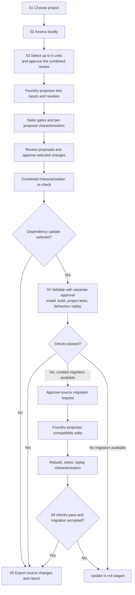
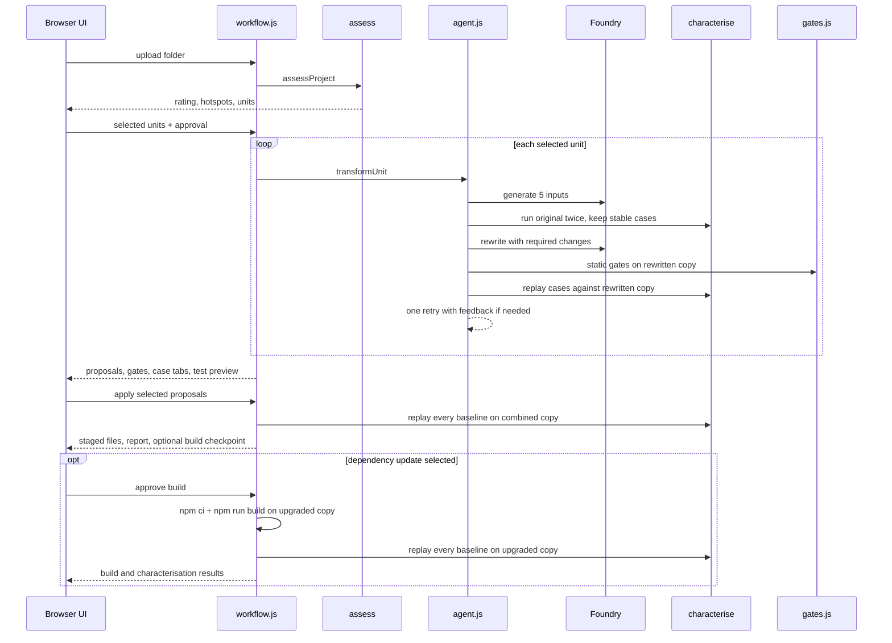

## Run The Demo

Requirements: Node.js 24 or later and a deployed Microsoft Foundry chat model for transformation. Local assessment works without Foundry configuration.

From the repository root, enter the demo folder. Create `.env` only if you do not already have one:

```powershell
Set-Location demos/legacy-codebase-transformation-web
if (-not (Test-Path .env)) { Copy-Item .env.example .env }
```

Set `FOUNDRY_API_KEY`, `FOUNDRY_ENDPOINT`, and `FOUNDRY_MODEL` in `.env` to your resource endpoint and deployment. Optionally set `FOUNDRY_REWRITE_MODEL` to a stronger deployment on the same resource for source rewrites; input generation keeps using `FOUNDRY_MODEL`. The API key stays in the local Node server and is never sent to the browser. Do not paste it into chat or commit `.env`.

Stop an existing Vite server for this demo before reinstalling dependencies. Then run:

```powershell
npm.cmd ci
npm.cmd run dev
```

Open `http://127.0.0.1:5173`. The API status is available at `http://127.0.0.1:5173/api/status`.

## Lifecycle

The demo moves through five stages. Each stage hands a defined output to the next. The page scrolls to the top whenever the workflow advances so each new stage opens at its heading and first controls.



The local assessment is deterministic and makes no network requests. After you approve the combined review, Foundry proposes changes. Optional npm Registry and OSV lookups run only when dependency review was selected. Characterisation runs once per proposal against its rewrite, then again across all selected proposals before they are applied.

A selected dependency update adds a separate approval checkpoint and another replay against the upgraded copy after the build passes. If an upgrade check fails and a supported migration guide exists, the UI offers a separate approval to request compatibility edits. The migration is staged only after the edited copy passes its checks and you accept it.

| Stage | Inputs | What happens | Outputs | Network or execution |
|-------|--------|--------------|---------|----------------------|
| 01 Choose project | A local project folder (up to 500 files, 25 MB) | The browser uploads supported files to the local Node server; `node_modules` and `dist` are excluded | An in-memory session holding the file bytes | None |
| 02 Assess locally | Session files and optional `debt.config.json` | Babel parses each source file, measures every function, applies the rules, and scores the project | A–E rating, per-file scores, hotspots, findings with line and column, selectable units, coverage gaps, and a dependency inventory | None |
| 03 Review proposals | Up to five selected units, approved findings, and combined approval | For each function, Foundry generates five inputs, the original runs twice for a stable baseline, Foundry proposes a rewrite, static gates run, and the rewrite replays the baseline. Optional dependency review retrieves npm Registry and OSV evidence; update candidates identify curated source migration support when available | One proposal per unit (`ready`, `rejected`, or `failed`), targeted findings, gates, cases, residual findings, attempt history, test preview, and optional dependency candidates | Foundry, optional npm Registry/OSV requests, and local function execution |
| 04 Validate | Applied proposals, selected package updates, and separate build approval | Shows package and lockfile diffs and commands before approval, then runs `npm ci`, `npm run build`, and the project's `npm test` with lifecycle scripts disabled in temporary copies. Tests run on the original and upgraded copies; a test gates the update only if it passed originally. Stable characterisation baselines replay against the upgraded copy. If checks fail and a curated migration is supported, a separately approved Foundry proposal can edit importing source files; the migration is rebuilt, retested, replayed, and accepted only after all checks pass | Build, project-test, and characterisation outcomes; updated manifests; and any accepted source migration edits | npm install, project build/test scripts, optional Foundry migration, and local function execution |
| 05 Export | The staged session | The server packages only the approved staged project | A ZIP with transformed source, `__characterisation__/*.test.js` files, updated manifests, and `CODE-TRANSFORMATION-REPORT.md` with source changes, dependency compatibility outcomes, and migration before/after edits | None |

Source-only runs skip stage 04. The uploaded folder is never modified. Project tests run only in stage 04 after you approve the disclosed commands. Sessions live in server memory, so restarting the dev server clears them.

### Dependency Upgrade Levels

Each update candidate is labelled patch, minor, or major from its semantic version change. For `0.x` packages, a minor version change is labelled major because it may contain breaking changes. The Allowed update level selector defaults to Patch only; choose Up to minor or Up to major to opt in to riskier upgrades. The server accepts a package name and level, then resolves the version from registry evidence, so the browser cannot request an arbitrary version.

### Curated Dependency Migration

A major upgrade can change how a package is called. Migration is offered only when a curated guide exists for the upgrade and the build, project tests, or characterisation fails on the upgraded copy. The current guide covers `date-fns` 1.x to 2.0 or later.
After a separate approval, the server sends Foundry the non-test source files that import the package, the curated notes, and the failure output. It accepts only complete edits to those listed files that parse with the original module format, then reruns install, build, project tests, and characterisation in a temporary copy, with one retry.
Nothing is staged until you accept a migration that passed every check. Passing checks are evidence, not proof of compatibility.

At stage 05, choose Open in VS Code beside Download transformed ZIP to save the approved project, generated tests, and report into a separate temporary folder and open that folder in a new VS Code window. The page displays the saved path.
Repeated clicks reopen the same copy without overwriting your editor changes. The copy remains after resetting the review; remove it when you no longer need it. This action requires the demo server and VS Code on the same machine.
Windows uses a standard user or system VS Code installation; other platforms require `code` on `PATH`. If opening fails, the ZIP download remains available.

## Step-By-Step Demo Guide

This walkthrough uses the headline `samples/invoice-desk` project. It shows source refactors and a breaking dependency upgrade that needs a source migration.

1. Optionally confirm the sample works on its own: from `samples/invoice-desk`, run `npm.cmd ci` and `npm.cmd start`. The CLI prints two invoice summaries with status labels.
2. Start the transformer with `npm.cmd run dev` from this folder and open `http://127.0.0.1:5173`. The header shows the configured model, or `Foundry not configured`.
3. Choose Select folder, pick `samples/invoice-desk`, then choose Run assessment.
4. Review the dashboard. The project rates D. The hotspots list `calculateDiscount` (nesting, complexity, magic numbers, a TODO), `buildInvoiceLines` (long function, unclear names), `formatLine` (seven parameters and the vague name `val`), `formatInvoiceStatus` (a six-way status-to-label branch chain), and a top-level statement with `var`, `==`, and a magic number. Select a hotspot to open its local detail:
   * Each finding shows its position as `Line N:Col` for an exact token, or `Line N` for whole-function metrics, which point at the function's first line.
   * The source preview has line numbers. Lines with approved findings are highlighted red, lines with only unapproved findings are grey, and the badge counts the findings on that line.
   * Choose a finding's position to scroll the source to that line, or choose a flagged line to highlight its findings in the list.
5. Select those five units. Ticking a unit approves all of its findings. Use each finding's checkbox to drop any you do not want changed, or Select all and Clear all for the unit. Clearing every finding deselects it.
  Only approved findings go to Foundry and the gates; other findings stay as they are. The approval band shows the approved count and source spans, package names and versions sent to npm/OSV when enabled, and which functions will execute locally.
6. Tick Also check npm dependencies if you want the dependency upgrade in this run. Leave it unticked for a source-only run: no npm Registry or OSV lookups happen and the dependency update and validate stage are skipped. Then approve once. While assessment or transformation runs, a spinner shows that work is in progress. Transformation also shows the current unit and step, such as baseline capture or rewrite, with a completed-unit count.
7. Review each proposal:
   * Approved findings targeted lists the findings you approved for that unit, with their line and column.
   * The BEFORE and PROPOSED columns show the replacement span.
   * The gate list shows each static and behaviour gate as PASS, FAIL, or NOT CHECKED.
   * The characterisation tabs show each case with its input, the original's result, and the rewrite's result. A failing case lists the exact fields that differ, for example `value[0].tax expected -7.42, got 0`, and the same differences go to the model for its one retry. The final Test file tab shows the exact `node:test` file that ships in the export.
   * Remaining findings list what the rewrite left behind. `too-many-params` on `formatLine` is expected because the signature is preserved.
   * Rejected proposals show both attempts and which gates each failed. They cannot be selected.
8. Tick the ready proposals. If a selected proposal is marked not-checked and has not been acknowledged, Apply opens a dialog listing the affected proposal and why characterisation did not run. Choose Go back to change the selection, or Acknowledge and continue to apply it without a behaviour check. The top-level statement has no function inputs, so it always needs acknowledgement.
9. Change Allowed update level to Up to major. Each candidate shows its level, and `date-fns` 1.28.4 to 4.x is marked Source migration supported. Select only the `date-fns` major update, then choose Review update diff and build.
   The server re-runs every stable baseline against the combined staged copy before anything is applied.
10. In Validate, the package section confirms a curated source migration is available. Inspect the package and lockfile diff and the exact commands, then approve the build and tests. The project test passes on the original upload but fails on the upgraded copy because date-fns 2.0 and later reject `YYYY` format tokens and date strings.
11. Choose Approve and propose migration. Foundry receives only `src/due-date.js`, the curated notes, and the failure output. Review the migrated code (expected shape: `parseISO` and `yyyy-MM-dd`) and its rerun build, project test, and characterisation results, then choose Accept migration and stage.
12. Download the ZIP. The generated tests are under `<project>/__characterisation__/`; from the extracted project folder, run them with `node --test __characterisation__`. Open `CODE-TRANSFORMATION-REPORT.md`: the Dependency Updates section reports that code changes were needed for compatibility, lists the applied migration edit with before and after code, and shows the build, project test, and characterisation results alongside the source refactors and the rating move from D towards B.

For a lower-risk dependency run, keep Allowed update level at Patch only and select the `lodash@4.17.20` patch update instead. The build and post-update characterisation pass without a migration, and the report states that no compatibility code changes were needed for the checks that ran.

For a shorter source-only run, use `samples/dispatch-desk`. Select `summarizeDispatch`, approve, review its cases and gates, apply, and download. There are no dependencies, so stage 04 is skipped.

## How The Parts Work

Each server module owns one responsibility. The UI calls them through a small HTTP API.

| Module | Responsibility |
|--------|----------------|
| `server/assess/` | Parses source with Babel (`parse.js`), measures lines, nesting, complexity, callbacks, and branch chains per function (`metrics.js`), applies rules and thresholds (`rules.js`), builds selectable function, statement, and file units (`units.js`), and converts findings into remediation minutes and A–E ratings (`score.js`). Entirely local and deterministic. |
| `server/foundry-client.js` | Sends one prompt per request to the Foundry chat completions endpoint with a strict JSON schema, bounded response size, timeout, and credential leak check. Rewrites use `FOUNDRY_REWRITE_MODEL` when set. |
| `server/transform/prompts.js` | Builds the input-generation prompt and the rewrite prompt. The rewrite prompt sends only the selected unit, lists each required change (exact identifiers to rename, where constants go, TODO comments to delete without acting on them), states hard metric limits, and forbids new behaviour. |
| `server/characterise/` | `harness.js` writes the project to a temporary folder, installs locked dependencies when needed, and runs each case in a separate `node --permission` process that can only read that folder. `runner.cjs` captures the return value, thrown error, argument mutation, and console output. `export.js` renders the replayable `node:test` file. |
| `server/transform/gates.js` | Applies the rewrite to a copy of the file and checks span, hash, syntax, invariants, scope, metric improvement, and new findings. |
| `server/transform/agent.js` | Runs one unit end to end: generate inputs, capture the baseline, request a rewrite, run the static gates, replay the baseline against the rewritten copy, and retry once with the failed gates, unresolved findings, and mismatched cases as feedback. |
| `server/dependency-review.js` | Inventories declared and locked npm packages, gathers npm Registry and OSV evidence, and labels the highest patch, minor, and major update options. |
| `server/dependency-build.js` | Resolves an approved package and level with `npm install --package-lock-only`, then runs `npm ci`, `npm run build`, and `npm test` with lifecycle scripts disabled in temporary copies. |
| `server/dependency-migration.js` | Holds curated migration guides, finds non-test files that import an upgraded package, requests Foundry edits, validates them, and reruns the checks with one retry. |
| `server/workflow.js` | Owns sessions, the five-unit limit, approval checks, proposal state, the combined re-check before apply, the post-update characterisation replay, characterisation test staging, and the change report. |
| `server/api.js` | Exposes `/api/status`, `/api/analyze/prepare`, `/api/sessions/:id/transform`, `/progress`, `/apply`, `/updates/prepare`, `/updates/build`, `/updates/migrate`, `/updates/migrate/accept`, and `/download`. |
| `server/editor-export.js` | Saves the applied output to a separate temporary folder and launches VS Code with `--new-window` through `/api/sessions/:id/open-in-vscode`. |
| `src/App.jsx` | Renders the stages, approval band, proposals, gate list, case tabs, build checkpoint, and export. |

### How They Work Together



The assessor is the single source of truth for findings. Gates rerun it on the rewritten file; a proposal must reduce targeted smells without adding new ones. Characterisation compares the rewrite with the original's recorded outputs.

The combined re-check catches interactions among proposals. A post-update replay checks for behavior changes caused by dependency updates. Generated tests let you replay the same cases with `node --test`.

## Assessment Rules

The assessor parses `.js`, `.cjs`, `.mjs`, and `.jsx` source with Babel. Assessment is local and deterministic. Parse failures appear as coverage gaps and are not silently treated as clean files.

| Rule | Default warning | Default high |
|------|-----------------|--------------|
| `long-function` | 40 nonblank lines | 80 nonblank lines |
| `deep-nesting` | depth 3 | depth 5 |
| `high-complexity` | 10 | 20 |
| `too-many-params` | 4 | 6 |
| `callback-nesting` | depth 3 | depth 4 |
| `long-branch-chain` | 6 branches | 10 branches |
| `bad-variable-name` | short, vague, or numbered-copy name | not applicable |
| `magic-number` | numeric literal outside the allowlist | not applicable |
| `loose-equality` | `==` or `!=` | not applicable |
| `var-declaration` | each `var` declaration | not applicable |
| `debt-marker` | `TODO`, `FIXME`, or `HACK` | not applicable |
| `long-file` | 300 nonblank lines | 600 nonblank lines |
| `empty-catch` | empty `catch` block | not applicable |

Function metrics exclude nested function bodies, except that callback nesting measures nested callbacks. Top-level `var`, loose equality, and magic-number findings can be transformed as one statement unit. A TODO outside a selected function is report-only. A magic-number replacement declares its named constant at the beginning of the selected function body.

Each finding contributes estimated remediation minutes. Ratings compare that estimate with an allowance of 0.5 minutes per source line: A is at most 5%, B at most 10%, C at most 20%, D at most 50%, and E is above 50%. Estimates are starting values for this demo and can be calibrated with `debt.config.json` at the project root.

Example configuration:

```json
{
  "rules": {
    "long-function": { "warn": 50, "high": 90 }
  },
  "nameAllowlist": ["cfg"],
  "vagueNames": ["payload"],
  "magicAllowlist": [0, 1, -1, 2, 100]
}
```

## Transformation Gates

The app asks Foundry for exactly five JSON argument cases only after you select a function and approve the combined action. It runs the original function twice in a temporary copy, drops unstable cases, and requires at least three stable cases for a checked baseline. If the baseline is unavailable or unstable, the proposal is marked `not-checked` and needs acknowledgement.

The runner supports top-level CommonJS functions in modules without executable top-level expressions. It captures return values, thrown errors, argument mutation, and console output. Class methods, nested functions, and ESM targets are not characterised in v1. Characterisation test files are included in the ZIP for functions with stable baselines.

Node 24's permission model restricts filesystem access and child processes for the runner, but it does not block network access. The consent panel says when uploaded functions will execute. Build and test commands also execute uploaded code in temporary directories that are not an OS sandbox. npm installation uses `--ignore-scripts`; lifecycle scripts remain disabled, and project tests run only after the stage 04 approval.

Static gates require an exact unchanged source span, valid updated syntax, preserved function name/parameter count/module exports/module format, no colliding helper names, metric improvement, and no new warning-or-higher findings. Statement rewrites also pass a scope check for unsafe `var` conversions. Named-constant declarations with literal values at the start of a function do not count toward its length, so extracting magic numbers cannot create a new `long-function` finding.

Each proposal replays its stable cases against the rewritten copy, and the gate message reports how many cases differ and why any case failed to run. A failed attempt receives one retry with the failed gates, unresolved findings, and up to three mismatched cases as feedback. Before apply, every stable baseline runs again against the final combined staged copy.

`too-many-params` remains visible when the original function signature is preserved. This signature-protected finding does not block a proposal when another actionable smell improves and all other gates pass.

## Validation

From this folder:

```powershell
npm.cmd test
npm.cmd run check
npm.cmd run build
```

The project tests exercise assessment rules, characterization behavior, static gates, workflow and API contracts, and dependency review/build behavior. The browser app uses `npm run dev` and requires user approval before source transfer, npm/OSV lookup, or local function execution.
