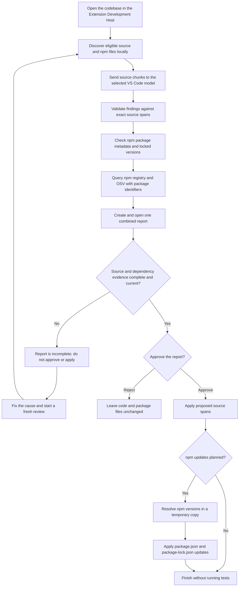
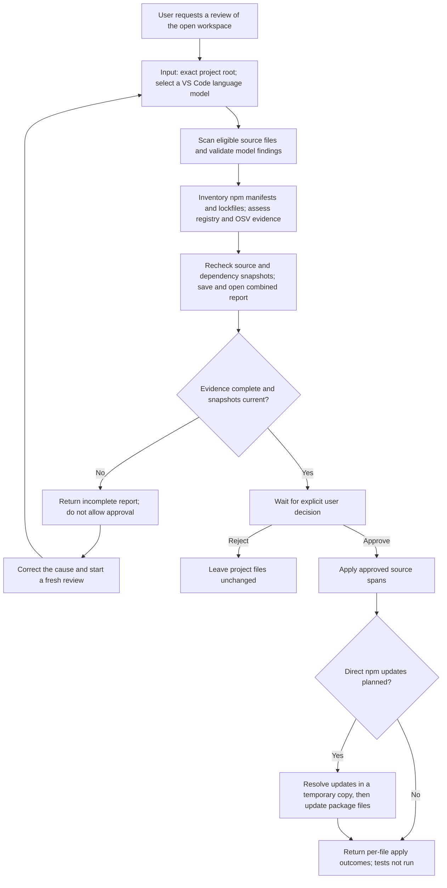

## Run The Demo

Prerequisites: VS Code 1.140 or later, GitHub Copilot Chat, an available tool-capable model, and Node.js 24 or later.

From the repository root, run these commands in PowerShell:

```powershell
npm.cmd --prefix demos/legacy-codebase-transformation/extension ci --ignore-scripts --registry=https://registry.npmjs.org/
$sample = (Resolve-Path "demos/legacy-codebase-transformation/fixtures/npm-dependency-demo").Path
$demo = Join-Path $env:TEMP ("npm-dependency-demo-" + [guid]::NewGuid().ToString("N"))
New-Item -ItemType Directory -Path $demo | Out-Null
Copy-Item "$sample/package.json", "$sample/package-lock.json", "$sample/.npmrc" -Destination $demo
Copy-Item "$sample/src", "$sample/data" -Destination $demo -Recurse
$extension = (Resolve-Path "demos/legacy-codebase-transformation/extension").Path
code --new-window --extensionDevelopmentPath="$extension" "$demo"
```

In the new window, confirm the title shows `npm-dependency-demo-...`. Open Copilot Chat, select **Codebase-Level Legacy Code Transformation Agent**, and send:

```text
Review and transform this codebase.
```

Read the report, then reply `approve` to apply its plan or `reject` to leave the code unchanged. To run again, close the window and repeat the commands to create a fresh copy.

The sample demonstrates a readability refactor and deprecated or vulnerable npm dependencies. Major dependency updates may require API changes. Review the report before approving. Tests are out of scope and are not run.

## How It Works



### Discovery And Data Sent

The extension discovers eligible source files and npm manifests/lockfiles under the open workspace.
Hidden, dependency, generated, and build folders are excluded. Source files are split into bounded
chunks and reviewed in sequence. Each model request includes the source path and chunk text, plus
review instructions, line lengths, and location data. The model is asked for findings with a category,
rationale, confidence, symbol, source span, original text, and replacement text. The extension
validates each finding against the supplied source before it enters the report.

Only source chunks go to the selected VS Code language model. `package.json` and lockfile contents
are not sent to it. Dependency inventory happens locally. For dependency evidence, the extension
sends package names to `registry.npmjs.org` and exact `{package name, ecosystem: npm, version}`
tuples from the lockfile to `api.osv.dev`. It does not send the full manifest or lockfile to those
services. After report approval, npm resolves planned direct updates in a temporary copy; npm may
request public metadata for transitive packages during that resolution.

### Report And Approval

The report combines source suggestions with npm registry, deprecation, and OSV evidence. It includes coverage, rejected model responses, dependency gaps, and a Transformation Plan listing the proposed source edits and direct dependency versions. It is saved in the extension's global storage and opened in the editor.

The plan is approvable only if source analysis and dependency evidence are complete and both snapshots still match the reviewed files. If the report is incomplete or stale, rerun the review instead of approving it. Rejecting a complete report leaves files unchanged.

Approving applies the proposed source spans, then resolves planned npm versions in a temporary copy before updating `package.json` and `package-lock.json`. Major-version API compatibility is not verified. The workflow does not run tests, builds, or the project. If the response reports a failed or partial apply, inspect the named files before continuing.

## Overall Agent Lifecycle

The lifecycle below shows how the agent moves from a review request to a report and, only after an explicit decision, an apply attempt. The earlier sections describe the scan and data-sharing details.



| Stage | Inputs | Outputs | Success criteria |
| --- | --- | --- | --- |
| Start review | User request, exact open workspace root, and an available VS Code language model | Review run scoped to that root | The intended workspace is scanned, and a model is available when source chunks need review. No project files are changed. |
| Analyze source | Eligible source files, bounded chunks, and model responses | Validated findings, coverage details, rejected-response details, and a source snapshot fingerprint | Every eligible chunk is reviewed without skipped chunks or rejected responses, and the source snapshot remains current. Findings must match exact source spans. |
| Assess npm dependencies | Locally inventoried `package.json` and lockfile data | Registry/deprecation evidence, OSV results for exact locked package versions, update candidates, and dependency snapshot fingerprint | Dependency evidence is complete, or the project has no applicable npm dependencies. Full manifests and lockfiles are not sent to the external services. |
| Build report and gate approval | Source findings and coverage, dependency evidence, and both snapshot checks | Saved and opened combined report; an approval-eligible `reviewId` only when the checks pass | Source analysis is complete, dependency status is `completed` or `not-applicable`, and both snapshots are current. Otherwise, the report is incomplete and cannot be approved. |
| Decide | Complete report and explicit user approval or rejection | Apply attempt after approval, or a rejection result | Only an explicit approval applies the report. Rejection leaves project files unchanged. |
| Apply | Approved review plan containing source finding IDs and planned direct npm updates | Per-file source outcomes and a dependency update outcome; tests are not run | Each planned source edit reports successful application, and planned dependency files are updated successfully. With no dependency updates, only source outcomes apply. Inspect named files if any outcome is failed, stale, or partial. |

An eligible report is not a guarantee that every edit will apply: files can change between review and approval, and npm resolution or editor writes can fail. The agent does not run tests, builds, or behavioral-equivalence checks as part of this workflow.
