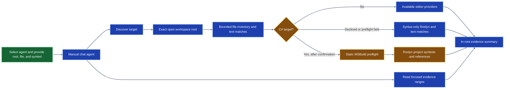

## Status

This standalone package provides the **Targeted Legacy Code Transformation Agent** workflow. For bounded codebase-wide discovery, use the separate [Codebase-Level Legacy Code Transformation demo](../legacy-codebase-transformation/README.md); its agent, tools, and session state are independently owned.

The primary Node demo combines the existing tests, eight characterization cases with captured
original outputs, and human review. The extension calls the configured Live Foundry deployment for
a one-function proposal, captures the original fixture baseline, and writes an analysis report with
an input/output table before the proposed changes. After separate human approval, it runs the
selected existing test and characterization cases in original and refactored copies. Only passing
checks and fresh source/report hashes permit the exact target-span write.

The Node runtime is fixed to Node.js 24.19.x. Characterization inputs and their execution harness
are extension-owned and currently specific to the bundled `transfer` target; they are not generated
for arbitrary Node functions. Other in-root Node targets can use the selected-test path but do not
receive automatic characterization cases. C# apply remains limited to the .NET 10 pizza fixture.
Temporary copies are not an OS sandbox.

Live Node proposal generation and original baseline capture were observed in the development host.
The latest report table has focused renderer coverage; selected-test transformed verification and
apply have local integration coverage. Full-suite exit capture and PowerShell-owned repository
validation remain outstanding; do not treat proposal generation as a successful application.

The extension currently provides project-root-bounded discovery and focused source-evidence reads. For C# analysis, it asks for confirmation before invoking language providers or MSBuild. Declining uses syntax-only Roslyn parsing over source text already read inside the selected root. The separate Roslyn worker also has an MSBuild analysis path with static checks for explicit imports and out-of-root project, source, or task-assembly paths.

The report pipeline re-runs bounded discovery, reads focused source/test/documentation evidence,
validates citations and target-span replacements, and writes a Markdown report. For eligible
one-span proposals on the pinned pizza and Node fixtures, it also runs the original fixture tests
and generated sample inputs in a disposable copy and records observed outputs. It never executes
arbitrary project code or the proposed transformation during report generation. Baseline capture
currently follows a successful Live proposal response; a failed request, including HTTP 429,
produces no proposal report or captured baseline.

The bundled chat agent has four owned tools: bounded discovery, evidence reads, report generation and ID-only apply. Proposal generation always uses Live Foundry and requires separate report-write and exact-context source-sharing confirmations. Application independently requires exact-diff confirmation; it uses pinned fixture checks by default and the selected local Node test flow when one is attached to the proposal.
Native JavaScript discovery and Roslyn-backed pizza reporting succeeded. C# reporting can use Roslyn's full declaration span when the editor provider is unavailable. These checks do not certify every provider/version or a complete dynamic call graph. Do not use MSBuild analysis with arbitrary projects.

## Requirements

* VS Code 1.140 or later to run the extension development host
* .NET SDK 10 to build and run the pizza fixture and Roslyn worker
* Node.js 24.19.x for controlled replay and selected-test execution; development validation used v24.19.0
* GitHub Copilot Chat and enabled TypeScript language features for the manually invoked agent and JavaScript providers

## Run The Pizza Fixture

From the repository root, run the existing tests:

```powershell
dotnet test demos/targeted-legacy-code-transformation/fixtures/dotnet/PizzaEligibility.sln --verbosity minimal
```

Run one pizza case with the same solution project:

```powershell
dotnet run --project demos/targeted-legacy-code-transformation/fixtures/dotnet/src/PizzaEligibility/PizzaEligibility.csproj -- 25.00 true
```

The command accepts `<subtotal> <isMember>` and prints the discount to two decimal places. The captured baseline cases are:

| Subtotal | Member | Discount |
| ---: | :---: | ---: |
| 25.00 | true | 2.50 |
| 49.99 | false | 0.00 |
| 50.00 | false | 5.00 |
| 75.00 | false | 7.50 |

## Run The Banking Fixture

The fixture is dependency-free; no npm installation or registry access is needed. From the repository root:

```powershell
npm.cmd --prefix demos/targeted-legacy-code-transformation/fixtures/node test
node demos/targeted-legacy-code-transformation/fixtures/node/src/runner.js "successful transfer"
```

Eight tests cover success, missing source, missing destination, both missing (source reason takes precedence), same account, zero, negative amount and insufficient funds. Every test and runner subprocess resets balances to `alice: 100, bob: 50`. Success transfers 25 and produces `alice: 75, bob: 75`; rejections return a reason and unchanged balances. The fixed runner prints JSON. An unknown case prints JSON to stderr and exits with code 2.

The deliberately nested [src/transfer.js](fixtures/node/src/transfer.js) is the legacy baseline. [jsconfig.json](fixtures/node/jsconfig.json) defines the JavaScript project for available TypeScript providers. Open that project and allow language-service loading to finish before discovery. Missing providers, empty results and dynamic references are incomplete evidence, not proof of no callers. The target Node runtime does not determine or certify the installed TypeScript service version.

## Check The Extension

From the extension directory, run the syntax and test checks:

```powershell
cd demos/targeted-legacy-code-transformation/extension
npm.cmd run check
npm.cmd test
```

The suite covers workspace-root validation, traversal and symlink rejection, filtered provider
locations, exact target spans, focused evidence reads, consent, Roslyn fallback and controlled
fixture discovery, proposal contracts, Live report generation through fake transport, cancellation,
and command registration. Approval tests cover stale source/report hashes, dirty buffers, modal
races, immutable candidates, byte-preserving edits, and local selected-test execution for generic
Node targets. Apply-time selected tests run in isolated baseline/transformed copies; generation-time
fixture checks also run the bundled fixture test. Dependency
installation, when needed, uses a supported lock and public npm tarballs with lifecycle scripts
disabled. The required runtime is Node.js 24.19.x. Bundled legacy source is never modified by tests.
Host UI smoke testing remains separate from tests using VS Code and Foundry transport test doubles.
Existing installation success is recorded for this lockfile; no reinstall is needed for these checks.

## Run The End-To-End Smoke Test

Start with the Node banking fixture. Run the following commands in PowerShell at the repository
root and keep that terminal open. A new fixture copy protects the bundled baseline and avoids
reusing an already-refactored source file. Launch only one development host at a time.

Use your existing VS Code profile so Copilot sign-in is retained. Do not add a temporary
`--user-data-dir`; that creates a fresh profile and can require signing in again. If you already
have the correct development host open with current Foundry settings and unchanged source, skip
setup and follow [Rerun The Demo](#rerun-the-demo).

### Check The Sample Apps

These fixture checks are optional but help catch a missing runtime before launching VS Code. Run them from the repository root:

```powershell
node --version
npm.cmd --prefix demos/targeted-legacy-code-transformation/fixtures/node test
dotnet --version
dotnet test demos/targeted-legacy-code-transformation/fixtures/dotnet/PizzaEligibility.sln --verbosity minimal
```

Use Node.js 24.19.x and .NET SDK 10. The Node fixture has no package-install step. The pizza test may restore its .NET packages on the first run.

### Create Disposable Copies

Paste this block into PowerShell at the repository root. It copies both sample apps into a fresh
temporary folder; no source in the repository is changed.

```powershell
$repoRoot = (Get-Location).Path
$fixtureRoot = Join-Path $repoRoot 'demos\targeted-legacy-code-transformation\fixtures'
if (-not (Test-Path $fixtureRoot)) {
  throw 'Run this block from the hve-core repository root.'
}

$smokeRoot = Join-Path $env:TEMP ('targeted-legacy-code-transformation-' + [guid]::NewGuid().ToString('N'))
$nodeRoot = Join-Path $smokeRoot 'node'
$pizzaRoot = Join-Path $smokeRoot 'dotnet'
$extensionPath = Join-Path $repoRoot 'demos\targeted-legacy-code-transformation\extension'
New-Item -ItemType Directory -Path $smokeRoot | Out-Null

robocopy (Join-Path $fixtureRoot 'node') $nodeRoot /E /XD node_modules .git
if ($LASTEXITCODE -ge 8) { throw 'Node fixture copy failed.' }

robocopy (Join-Path $fixtureRoot 'dotnet') $pizzaRoot /E /XD bin obj
if ($LASTEXITCODE -ge 8) { throw 'Pizza fixture copy failed.' }

Write-Host "Node fixture copy: $nodeRoot"
Write-Host "Pizza fixture copy: $pizzaRoot"
```

Keep this PowerShell window open; the next commands use the paths stored in `$nodeRoot`, `$pizzaRoot`, and `$extensionPath`. The bundled fixtures remain unchanged. Apply writes only to the disposable copy.

### Configure Foundry And Launch

The extension uses Live Foundry for proposal generation even when the chat harness is Local.
Use the current resource endpoint, API key, and deployment name in the same PowerShell terminal
that launches VS Code. Keeping the same deployment name does not update an old endpoint or key.
The API key prompt below is hidden; never paste credentials into chat or the README.

```powershell
$secureApiKey = Read-Host 'Foundry API key' -AsSecureString
$env:api_key = [System.Net.NetworkCredential]::new('', $secureApiKey).Password
$env:model = Read-Host 'Foundry deployment name'
$env:endpoint = Read-Host 'Foundry endpoint'
Remove-Variable secureApiKey
```

Use a canonical resource endpoint such as `https://RESOURCE.openai.azure.com`, not a project URL.
Changing variables in a terminal does not update an already-running extension host. If replacing
old settings, save your work and fully exit VS Code, then launch from this configured terminal.
Closing VS Code does not remove the sign-in stored in your normal profile.

Run this once to open the Node project and its target file with the targeted extension loaded:

```powershell
code --new-window --extensionDevelopmentPath="$extensionPath" "$nodeRoot" (Join-Path $nodeRoot 'src\transfer.js')
```

Run the Node smoke test first. After its development host closes, launch the pizza copy from the same PowerShell window:

```powershell
code --new-window --extensionDevelopmentPath="$extensionPath" "$pizzaRoot"
```

If `code` is not on `PATH`, use the default Windows installation's launcher in the same terminal:

```powershell
& "$env:LOCALAPPDATA\Programs\Microsoft VS Code\bin\code.cmd" `
  --new-window --extensionDevelopmentPath="$extensionPath" `
  "$nodeRoot" (Join-Path $nodeRoot 'src\transfer.js')
```

Alternatively, open the extension folder in VS Code and press F5 with
**Legacy transformation: Node fixture copy** selected in [launch.json](extension/.vscode/launch.json).
Enter `$nodeRoot`'s printed path when prompted. Use the resulting **Extension Development Host**,
not an ordinary project window. Its VS Code process must already have the current Foundry settings.

### Generate And Review A Proposal

1. Trust the disposable workspace if prompted, open Chat, and select the **Local** harness.
2. Choose **Legacy Code Transformation Demo** in the agent picker. If missing, verify that this is
  the extension development host and that **Legacy Code Transformation: Generate Proposal Report**
  appears in the Command Palette. Chat Diagnostics can show customization-loading errors.
3. Paste the following prompt; the agent can resolve the open project root and absolute file path.

```text
Analyze and propose a readability refactor for transfer in src/transfer.js, preserving behavior.

Use tests/transfer.test.js as the existing node:test file and keep its contents local.
Also build 5-10 characterization cases, run them against the original code, and capture the outputs as the baseline.

Include the input/output table in the analysis report and explain what the observations require the refactor to preserve.
Show me the report and exact diff, then stop for human review. Do not apply anything yet.
```

1. Review the report-creation confirmation. It permits original fixture execution, not a source edit.
2. Review the separate source-sharing prompt. Check its destination and deployment name before
  approving. Selected test contents remain local and are excluded from the Foundry request.
3. Inspect the analysis report, not only the chat response. It should contain the selected test
  path/hash, **Characterization Baseline Analysis** table, review implications, eight captured
  `transfer` cases, exact proposed replacement, and unknowns. The characterization table retains
  captured stdout, stderr, and exit codes without a duplicate supplemental sample section.

Generation runs the original pinned fixture's existing eight tests, fixed replay, and eight
characterization cases in temporary copies before writing the report. It does not execute the
refactored code or change source. The inputs are currently extension-owned fixture cases, not
model-authored executable tests. Captured outputs inform the report's review analysis; they are
not sent back to Foundry to generate the proposal.

For the pizza demo, select `CalculateDiscountAmount` in
`src/PizzaEligibility/PizzaDiscountCalculator.cs`. Its existing four-test/four-fixed-case flow is
separate from the Node 5-10 characterization requirement. Only approve MSBuild/provider loading
for that trusted fixture; declining permits syntax-only analysis.

If proposal generation reports missing configuration, confirm that the three environment variables were set in this PowerShell window before launching the development host. A declined confirmation, failed Live request, ambiguous symbol, or invalid proposal does not create a successful proposal.

### Apply And Verify The Proposal

After reviewing the baseline table, analysis, and exact diff, send this in the same chat:

```text
Apply the reviewed proposal only if the existing test passes and all characterization outputs match the captured baseline. Show me the verification and application report.
```

1. Review the mandatory extension modal, including the exact diff, test path, runtime, install
  decision, characterization replay, and output retention. Confirm **Apply exact proposal** only
  if you trust the code; cancellation leaves the source unchanged.
2. The extension prepares original and transformed copies. For this dependency-free fixture no
  npm install is needed. In other supported npm projects, dependencies are installed once using
  a public lockfile and `npm ci --ignore-scripts` before cloning the copies.
3. The selected test must pass against the original. Characterization outputs must match the
  captured baseline. Then the exact replacement is tested in the transformed copy, using the
  same test and inputs. Failures or stale files block the source write.
4. Inspect the separate verification report. Success must state `Application: applied`, include
  passing original/refactored checks and characterization observations, and record the applied
  source hash. `Verification: passed` alone does not prove that the source write completed.

You can instead run **Legacy Code Transformation: Review and Apply Proposal** from the Command
Palette and select the candidate. Both paths use the same ID-bound store and extension modal.

Repeat the generate and apply steps in the other development host to test the second sample app. Keep each temporary fixture copy if you want to inspect its reports; remove the printed `$smokeRoot` directory when you no longer need it.

### Rerun The Demo

* If you have not applied a refactor and the settings are current, run **Developer: Reload Window**
  to load updated extension code, select the agent again, and resend the generation prompt.
* Reloading clears stored proposal IDs. Generate a new report and review it again before apply.
* If you already applied a change, close that development host and run **Create Disposable Copies**
  again in the setup terminal. Launch the new `$nodeRoot`; do not reset or overwrite your old copy.
* If Foundry settings changed, fully exit VS Code and launch from the terminal with the new values.
  Verify the resource and deployment in the source-sharing confirmation; never print the API key.
* If generation returns HTTP 429, no baseline/report is created in the current ordering. Check the
  configured deployment's rate limits or quota before retrying; do not assume a code-test failure.
* Preserve reports you want to inspect. The original proposal report is immutable; verification
  creates a separate report, and repeated runs create new filenames.

## Generate A Live Proposal Report

1. Configure `api_key`, `model`, and `endpoint` in the environment that will launch the extension host. Fully restart VS Code after changing inherited environment variables.
2. Open the fixture folder as the workspace root and select the saved target source file in the editor.
3. Run **Legacy Code Transformation: Generate Proposal Report** from the command palette.
4. Pick the opened project root, enter `CalculateDiscountAmount` or `transfer`, and describe the
  requested refactor. When using the agent for a Node target, optionally provide one project-relative
  `.js`, `.cjs`, or `.mjs` test file that uses Node's built-in `node:test` runner. Its contents remain
  local. There is no Mock option; proposal generation always calls the configured Live deployment.
5. Review and confirm report creation, then separately review and confirm the exact source-sharing prompt. Rejecting either prompt stops generation without a successful proposal.
6. Review the report that opens in the editor. Source files remain unchanged.

Foundry output is untrusted data and must pass local target, citation, and exact-span validation before a report is created. A missing configuration, declined consent, failed model request, ambiguous symbol, or missing full span produces no successful proposal. Use only the controlled pizza fixture for C# project-loading analysis. Reports and model prose are never instructions or authorization.

Reports are saved exclusively as uniquely named Markdown files under `reports/legacy-code-transformation/` inside the selected opened root. The `legacyCodeTransformation.reportDirectory` setting can select another project-relative artifact directory.
Hidden, dependency, source directories, directories containing discovered source/project files, and symlink ancestors are rejected before writes. Reports never overwrite an existing file. Cancellation removes any newly created report and empty output directories.

Reports retain editor references, caller edges, Roslyn diagnostics, text matches, collected tests/docs,
and provider limitations separately from unverified model prose. Eligible pizza and Node fixture reports
include actual original-code outputs, test status, and fixture fingerprints. A selected-test report for
the pinned `transfer` target also includes 8 characterization inputs and their captured original outputs.
The baseline analysis table appears before the proposed changes and distinguishes observations from
expectations. Other targets remain unexecuted during generation. Capturing a baseline does not run the proposed transformation or claim
equivalence. Proposal, normalized target-span, and evidence-catalog SHA-256 values are recorded; the
target-span hash is not a full-file hash or an approval token.

In live mode, provide a refactor request, or use the default goal of improving readability and
maintainability while preserving behavior. The extension shows the exact request and collected source
context before sharing them with the configured model. The request is recorded in the proposal report
and apply confirmation. The Node `transfer` path uses eight structured characterization inputs,
within its 5-10 case limit, covering success, rejection reasons, and boundary amounts. The pizza
fixture retains its separate locally generated membership and threshold cases.
The model does not provide sample inputs or expected outputs, tests, commands, scripts, or code outside the selected
target span. The extension validates the inputs and calculates expected results using fixture rules.
During report generation, the fixed harness runs these inputs against the original pinned fixture and
records actual stdout, stderr, and exit codes beside the extension-owned expectations. During approved
application, the fixed harness runs the proposed code and compares its observations with this captured
baseline. Live Foundry proposals accept a custom refactor
request and can include bounded supplemental inputs for the controlled fixture runners.

This demo analyzes one selected target at a time. Whole-codebase analysis and dependency modernization are future capabilities; they are not supported by this workflow.

## Review And Apply A Controlled Proposal

Use a disposable copy of either fixture, keeping the bundled source as the baseline. For pizza, copy its solution, source project and test project without `bin`/`obj`. For Node, copy its manifest, JavaScript project configuration, source and test files. Open that copy as the workspace root.

1. Generate and review a Live Foundry report for the saved `CalculateDiscountAmount` or `transfer` target in that copy.
2. Run **Legacy Code Transformation: Review and Apply Proposal** and select the stored candidate.
3. Review the mandatory modal's exact affected file, original, replacement, diff, proposal ID, proposal hash, and full source-file hash. Cancel leaves source unchanged.
4. Confirm **Apply exact proposal**. With a selected Node test, the extension runs that existing `node:test` file and replays the captured characterization cases on baseline and transformed copies before writing the exact approved span.
5. Review the verification and application Markdown report that opens. It records owned process commands, test stdout/stderr/exit codes, verification status, and coverage limits; pinned fixture reports also record their inputs, outputs, and visible working-directory file changes. After a successful source write, it records `Application: applied` and the resulting source hash. A failed verification or a cancelled/rejected post-verification apply records that the source was not applied.

Candidates are deeply immutable and memory-only for the current extension-host lifetime. No-change reports are not candidates. Generation captures the full saved UTF-8 source bytes and document version before discovery; apply rechecks them and the original report hash before and after confirmation, after replay, and before writing.
Report edits, dirty source/report buffers, changed document versions, changed source anywhere in the file, or changed roots invalidate application. Stale candidates remain listed but cannot apply; generate a revised report and obtain fresh approval.

Application preserves UTF-8 BOM and LF/CRLF bytes outside the exact line/character span. Mixed line endings are unsupported. The report is never edited to insert test claims: observed evidence goes into a new, exclusively written Markdown report in the same safe artifact directory.

Without a selected test, a single replacement of the selected target span can be verified on the
pinned pizza or Node fixture, including a Live Foundry proposal that differs from the fixture's
original implementation. The selector rejects changed fixture files, other targets, and multi-file
edits before execution. Pizza uses fixed `dotnet` arguments, a public-source NuGet configuration and
disabled inherited MSBuild directory imports.

The pinned Node fixture uses the installed Node executable, eight reset-state inputs and one fixed
CLI error case. For a selected-test proposal, the extension accepts one in-root Node target span and
runs the chosen test with Node's built-in runner. For `transfer`, it additionally replays the eight
characterization cases and compares their outputs with the reviewed baseline. No automatic sample
harness is configured for other Node targets. It checks Node.js 24.19.x before installation
or tests, installs once with `npm ci --ignore-scripts` only when dependencies are declared, and
accepts only lockfile tarballs from `registry.npmjs.org`. The test path and hash are retained locally;
test contents are not sent to Foundry. Both paths use native spawn without a shell, a restricted
child environment, cancellation, finite timeouts and bounded output.

The approved replacement executes during verification in a disposable copy. That copy is not an
operating-system sandbox, so review the exact diff and continue only if you trust the proposed code.
Extension-generated sample inputs are data passed to fixed extension-owned runners, not model-authored
test code. Selected test files and imported project code run with the user's permissions; the temporary
copy is not an OS sandbox. C# remains limited to its pinned fixture. A replay mismatch,
launch failure, timeout, or cancellation leaves the selected source unchanged; there is no rollback
over concurrent user edits or automatic repair.

The registered `legacy_code_transformation_demo_apply_proposal` tool accepts only a stored proposal ID, never a patch or caller approval flag. It is registered only when extension-owned confirmation is available and uses the same store and gate as the command. Tool auto-approval does not bypass the modal. Generation through chat and commands shares candidates; no candidate survives an extension-host restart.

Each pristine fixture supports one approved transformation. After application its fingerprint differs and the old ID is consumed. Use a new pristine copy for another demonstration; do not expect automatic rollback or successive transformations.

Passing fixture tests and representative inputs is sampled evidence, not formal equivalence.
Replay compares stdout, stderr, exit codes, JSON banking balances, and visible files in each working
directory. External, network, timing and hidden environment effects remain unknown. Generic Node
verification supports one user-selected `node:test` file, not arbitrary build/test scripts or a
general sandbox. Java and non-fixture C# apply are unsupported.

## Live Foundry Configuration

Proposal generation always uses Live Foundry. The extension reads these exact lowercase environment variable names from the VS Code extension-host process:

| Variable | Value |
| --- | --- |
| `api_key` | Resource API key, supplied through your environment without logging or committing it |
| `model` | Deployed model name with strict structured-output support |
| `endpoint` | `https://RESOURCE.openai.azure.com` or `https://RESOURCE.services.ai.azure.com`, optionally ending in `/openai/v1/` |

Restart the VS Code extension development host after changing its inherited environment. A value set only in an already-open integrated terminal does not update the existing extension-host process. No `.env` loader is included; do not commit `.env` files or real secrets. API keys are not stored in VS Code SecretStorage, reports, or logs.

The extension-owned modal displays the destination, model, and exact collected context before sending it. Declining sends nothing and writes no proposal report. Only HTTPS resource endpoints are accepted; project endpoints, arbitrary hosts, user information, ports, queries, and fragments are rejected.
The adapter uses native `fetch`, `api-key` authentication, and strict JSON Schema at `/openai/v1/chat/completions`, with no redirects, a finite timeout, cancellation, and bounded diagnostics for network, HTTP status, refusal, incomplete output, response parsing, and local sample-input validation. Diagnostics never include response bodies, source context, endpoint values, or credentials. Refusal, invalid JSON, invalid citations, or transport failure is a failure; no proposal report is generated.

The endpoint/request contract follows Microsoft's [v1 API lifecycle](https://learn.microsoft.com/en-us/azure/foundry/openai/api-version-lifecycle)
and [structured outputs REST documentation](https://learn.microsoft.com/en-us/azure/foundry/openai/how-to/structured-outputs).
A successful Live Node proposal was observed in the smoke workflow; that does not certify other
resources, deployments, quota, or permission to share non-demo source.

## Native Validation And Limits

Earlier fixture smoke testing verified disposable before/after behavior and applied approved source
spans: pizza passed four tests and four fixed cases, and banking passed eight tests and nine process
cases. Node cancellation left fixture files unchanged. A separate pizza cancellation demonstration
was skipped; shared cancellation has automated coverage.

The current selected-test smoke reached a successful Live proposal and captured all eight original
characterization outputs without editing source. Native transformed selected-test application is
not yet confirmed for that run. The analysis table and selected-test verification have focused
automated coverage. Treat generation, verification, and application as separate outcomes.

Repeated demonstrations require pristine disposable copies and separate host-launch permission. Installed TypeScript service version, comprehensive provider compatibility and live resource/model compatibility are not certified. PowerShell-owned repository checks remain pending. Native smoke does not authorize live calls, server/browser/model setup, provisioning or credential access.

## Safety Boundaries

* Use only the controlled pizza fixture when exercising MSBuild loading. Native smoke coverage is limited to the two known controlled baselines.
* MSBuild design-time targets may invoke project-defined tasks. The separate BuildHost process is not a sandbox. Confirm before C# provider or MSBuild analysis.
* If confirmation is declined or root preflight rejects a project, report syntax-only results and text matches as lower-fidelity evidence; do not describe them as semantic references.
* Do not run arbitrary project builds or package test scripts. Generic Node verification uses only
  the selected `node:test` file after confirmation. Automatic characterization execution is limited
  to the known `transfer` fixture harness; C# remains fixture-only.
* Do not send non-demo source to Foundry until its endpoint is configured and data-handling permission is confirmed.

## How The Workflow Works

### Owned Agent Tools

The extension contributes the **Legacy Code Transformation Demo** agent to the VS Code agent picker. Discovery and evidence reads remain read-only. The additional owned report tool writes only validated Markdown, and the ID-only apply tool uses the same candidate store as commands. Manual invocation is enabled; automatic model invocation and nested delegation are disabled.
The registration lives in [`extension/src/extension.js`](extension/src/extension.js), while the agent instructions are in [`extension/agents/legacy-code-transformation.agent.md`](extension/agents/legacy-code-transformation.agent.md).



The project root must resolve to an exact open VS Code workspace folder. Discovery searches selected source, documentation, and project-file patterns while excluding common generated and dependency folders. Paths are canonicalized and checked against the root before files are read or locations are returned.

The focused evidence tool accepts normalized project-relative paths and inclusive, one-based line ranges, then checks containment again before reading. These checks reject ordinary traversal and symlink escapes; they are not an operating-system sandbox.

For C# targets, the user sees a confirmation before project-loading analysis. Declining uses syntax-only parsing and bounded text matches, and semantic references remain unresolved. Continuing runs a static preflight before the Roslyn worker opens the controlled project.

The preflight rejects explicit imports and dynamic or out-of-root project, source, or task-assembly paths, but MSBuild design-time targets can still run code. Use this path only with the pizza fixture. Roslyn and editor-provider results are evidence about references and calls, not a complete dynamic call graph.

The agent can request focused caller or documentation excerpts after discovery, then generate a
report when requested. It must not read the selected test into model context. Project content,
reports, and model output are untrusted data, not instructions. Controlled fixture baseline capture
belongs to generation; selected-test and transformed execution belong to approved apply verification.
Discovery remains read-only, and generic build/package test scripts are unsupported.

### Proposal Lifecycle: Capture, Review, Apply

The report command and report tool move from discovery into a reviewable proposal. Eligible pinned targets capture original behavior before the report is written. After review and separate approval, transformed behavior is compared with that captured baseline before the selected source can change.

```mermaid
flowchart LR
  current["Report command or confirmed agent tool"] --> collect["Collect source, tests and docs"]
  collect --> foundry["Consent-gated Live Foundry adapter"]
  foundry --> validate["Validate exact target span and catalog citations"]
  validate --> baseline["Capture original pinned-fixture tests and sample outputs when supported"]
  baseline --> report["Write analysis table, captured outputs, and exact proposal"]
  report --> human["Human reviews baseline evidence and diff"]
  human --> approve["Explicit apply request and extension confirmation"]
  approve --> replay["Run existing test and characterization cases in original/refactored copies"]
  replay --> recheck{"Checks passed and source/test/report still current?"}
  recheck -->|Yes| apply["Apply only the approved target span"]
  recheck -->|No| reject["Leave source unchanged; revised proposal required"]
  apply --> outcome["Write separate verification and application report"]
  reject --> outcome
  classDef current fill:#1e40af,color:#f8fafc,stroke:#bfdbfe,stroke-width:2px;
  class current,collect,foundry,validate,baseline,report,human,approve,apply,replay,outcome,recheck,reject current;
  linkStyle default stroke:#64748b,stroke-width:2px;
```



The report command connects the proposal contract and renderer to owned discovery, evidence reads, the isolated adapter, pinned-fixture baseline capture, and safe report writing. The validator rejects invented citations, out-of-range citations, a different target, traversal paths, empty or disjoint original text, multiple replacements, and changes not replacing the exact selected span. Outside-target helper extraction is unsupported until explicitly implemented.

These checks establish structural grounding, not that a proposed replacement is correct or behavior-preserving. The report is a proposal only; rendering it does not edit source.

Before applying a change, the extension-owned confirmation shows the exact file and edits. Approval is bound to the stored proposal, its content hash, the generation-time source-file hash, saved version, original report bytes, and exact diff.

A cancelled, stale, or source-mismatched proposal must not change files. Edits beyond the approved diff require a revised proposal and fresh approval.

Generation captures characterization outputs for pinned fixtures after their original tests pass.
Approved verification compares the proposed code with that baseline. Pizza covers four fixed cases
and four tests; Node `transfer` covers 8 characterization inputs and its existing tests. With a
selected Node test, the extension also runs that test on baseline and transformed copies. Any failed
check stops application and requires a revised proposal, never an unapproved repair.

Live Foundry is required for proposal generation and remains consent-gated. Read-only discovery can
run without it. Local automated tests use a transport test double; credentials and customer source
must not be stored in tracked files. The Local chat harness does not change this deployment choice.

The demo is outside root `.github` distribution discovery. Root HVE plugin membership, VSIX packaging and generated reference documentation are intentionally unchanged; no root packaging-generation commands apply to this standalone extension.
